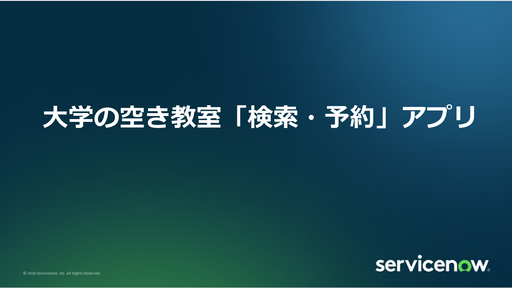
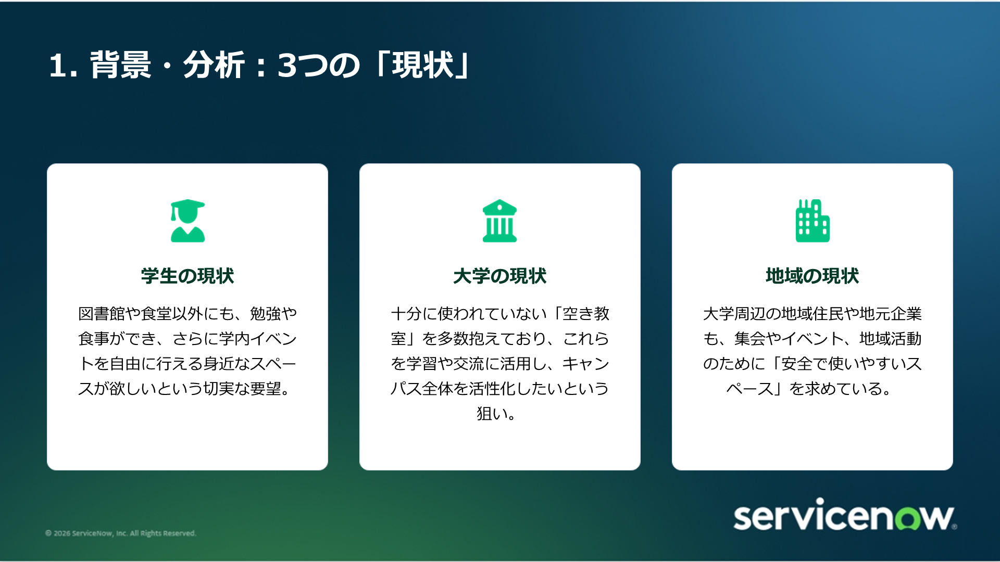
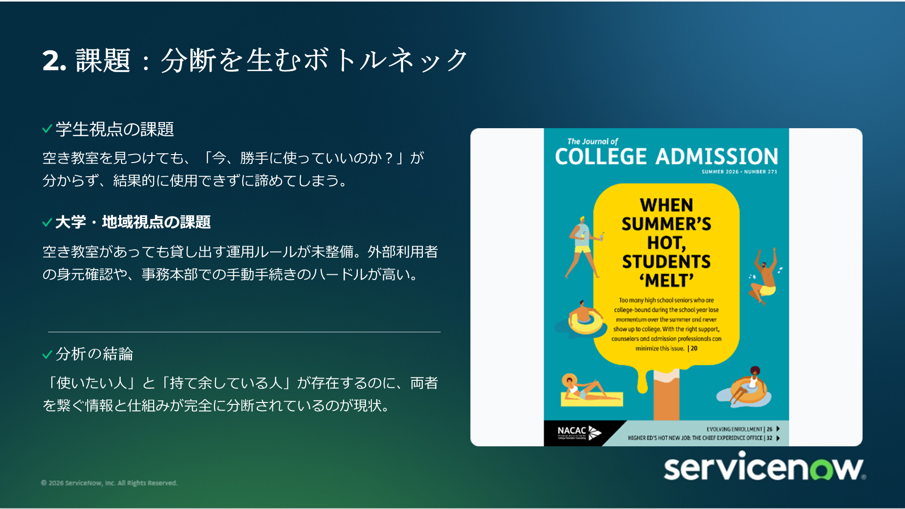
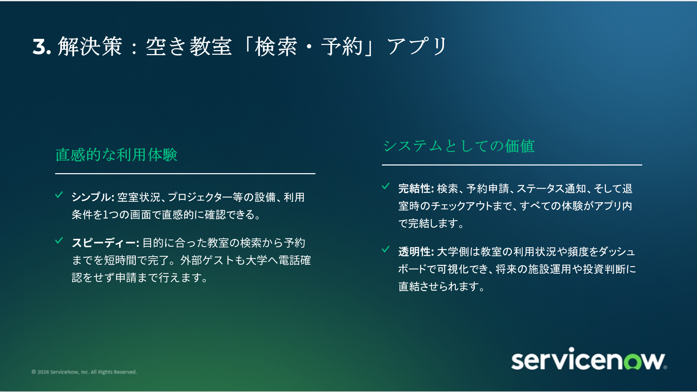
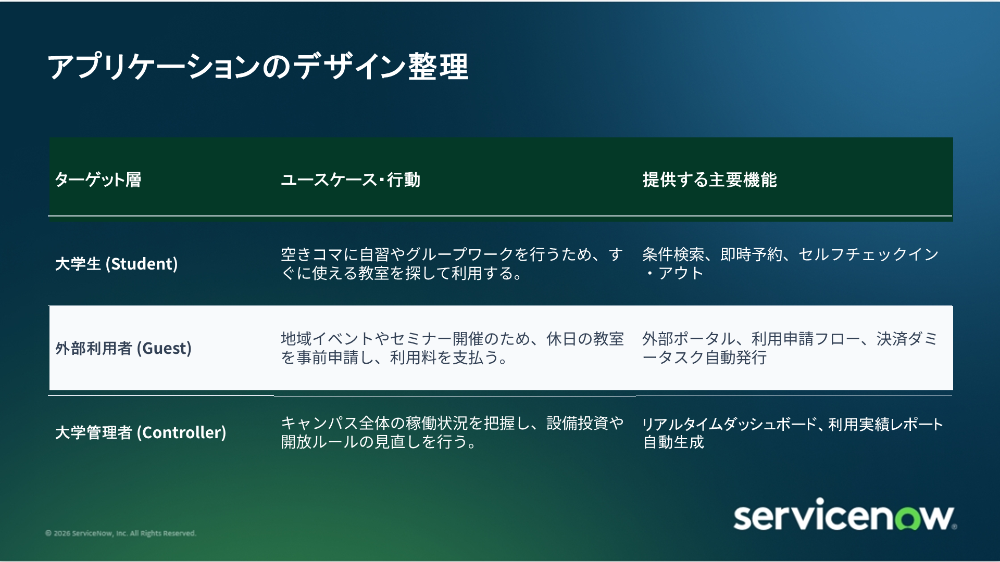
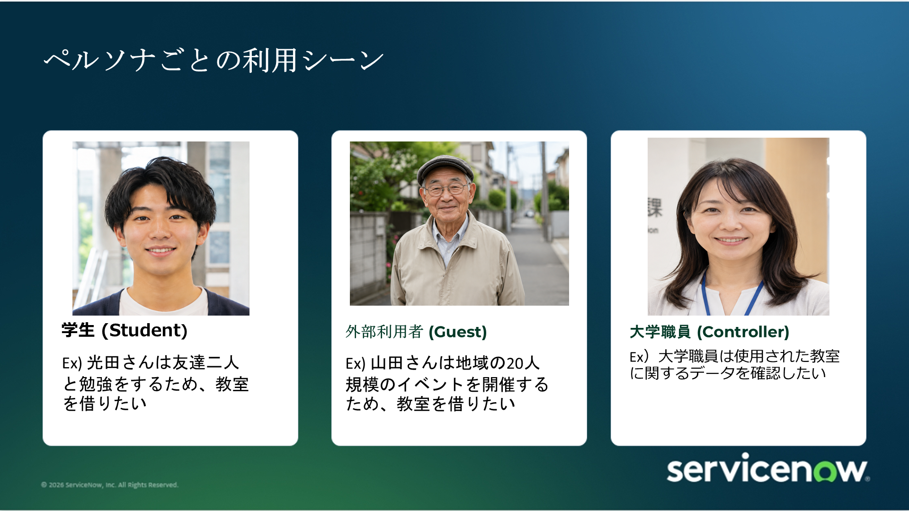
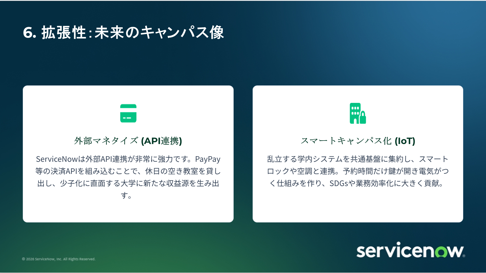
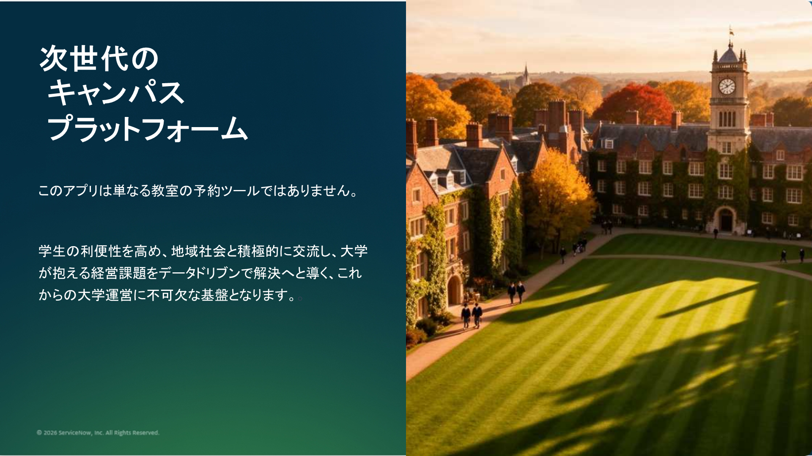

# 大学の空き教室「検索・予約」アプリ
### ServiceNowを活用した次世代スマートキャンパスDXプラットフォーム

[](#)
[](#)
[](#)
[](#)
[](#)

> 本リポジトリは、大学内の遊休資産である「空き教室」の有効活用とキャンパス活性化を目的として企画・設計した、**ServiceNowベースの空き教室「検索・予約」アプリケーションおよびスマートキャンパスDXプラットフォーム提案**のポートフォリオです。

📄 **[プレゼンテーション資料（PDF版スライド）の閲覧・ダウンロードはこちら](workshop.pdf)**  
📊 **[PowerPoint形式（PPTX）のダウンロードはこちら](workshop.pptx)**

---

## 📌 目次 (Table of Contents)
- [1. プロジェクト概要 (Executive Summary)](#1-プロジェクト概要-executive-summary)
- [2. 背景・分析：3つの「現状」 (Context & Needs)](#2-背景分析3つの現状-context--needs)
- [3. 課題：分断を生むボトルネック (Core Bottlenecks)](#3-課題分断を生むボトルネック-core-bottlenecks)
- [4. 解決策：空き教室「検索・予約」アプリ (Proposed Solution)](#4-解決策空き教室検索予約アプリ-proposed-solution)
- [5. 要件定義 & 機能デザイン整理 (Requirements & Design)](#5-要件定義--機能デザイン整理-requirements--design)
- [6. ペルソナと利用シーン (Personas & Use Cases)](#6-ペルソナと利用シーン-personas--use-cases)
- [7. 拡張性：未来のキャンパス像 (Future Scalability)](#7-拡張性未来のキャンパス像-future-scalability)
  - [① 外部マネタイズ (決済API連携)](#-外部マネタイズ-決済api連携)
  - [② スマートキャンパス化 (IoT・SDGs連携)](#-スマートキャンパス化-iotsdgs連携)
- [8. まとめ：キャンパスDXの提供価値 (Vision)](#8-まとめキャンパスdxの提供価値-vision)
- [9. リポジトリ構成 (Repository Structure)](#9-リポジトリ構成-repository-structure)

---

## 1. プロジェクト概要 (Executive Summary)

<p align="center">
  
</p>

大学キャンパスには、授業時間外や休日に十分に利用されていない「空き教室」が数多く存在します。一方、学生は自習やグループワークの場所を求め、地域住民・地元企業は安全で手頃なイベントスペースを求めています。  
本プロジェクトでは、**「使いたい人」と「持て余している空間」を繋ぐ仕組みが分断されている課題**に着目し、ServiceNowプラットフォーム上に統合型の教室予約・管理エコシステムを構築する企画を提案しました。

単なる教室予約システムにとどまらず、**学外向け有料貸出による大学の新たな収益化（マネタイズ）**や、**スマートロック・空調連携（IoT）による省エネ・SDGs推進**までを見据えた包括的なキャンパスDXソリューションです。

---

## 2. 背景・分析：3つの「現状」 (Context & Needs)



キャンパス空間を巡る3者のステークホルダー（学生・大学・地域）の現状とニーズを分析しました。

| ステークホルダー | 現状と潜在ニーズ |
| :--- | :--- |
| **🎓 学生の現状** | 図書館や学食以外にも、自習やグループワーク、食事、学内イベント等を気軽に行える身近なスペースが欲しいという切実な要望がある。 |
| **🏛️ 大学の現状** | 授業時間外に十分に活用されていない「空き教室」を多数抱えており、これらを有効活用して学内交流を活性化し、キャンパス全体の価値を向上させたい。 |
| **🏘️ 地域の現状** | 大学周辺の地域住民や地元企業も、勉強会やセミナー、コミュニティイベントのために「安全で利用しやすい公共スペース」を求めている。 |

---

## 3. 課題：分断を生むボトルネック (Core Bottlenecks)



### 分断を生んでいる3つの要因
1. **学生視点の課題**:  
   物理的に空いている教室を見つけても、「今勝手に使って良いのか？」「次の授業がいつ入るのか？」が分からず、結果として利用を躊躇・断念してしまう。
2. **大学・地域視点の課題**:  
   空き教室を開放・貸し出そうにも、外部利用者の身元確認や事務窓口での手動申請手続きのハードルが高く、管理コストがネックとなり運用ルールが未整備のまま放置されている。
3. **分析の結論**:  
   **「使いたい人（需要）」と「持て余している空間（供給）」がキャンパス内に共存しているにもかかわらず、両者を繋ぐ情報インフラと業務プロセスが完全に分断されている。**

---

## 4. 解決策：空き教室「検索・予約」アプリ (Proposed Solution)



ServiceNowプラットフォームのワークフロー統合力とポータル機能を活用し、利用体験と運用管理の両面を刷新します。

### 直感的な利用体験 (User Experience)
- **シンプル**: 空室状況、定員、プロジェクターやホワイトボード等の設備条件を1つの画面で直感的に検索・確認。
- **スピーディー**: 条件絞り込みから予約完了まで数タップで完結。外部利用者も電話確認なしでポータルから即座に申請可能。

### システムとしての価値 (Business & Operational Value)
- **完結性**: 空き状況検索、利用申請、承認ワークフロー、ステータス通知、入退室のセルフチェックイン/アウトまでアプリ内で一気通貫。
- **透明性 & データ活用**: 大学管理者は各教室の稼働率・利用頻度をリアルタイムダッシュボードで可視化でき、データに基づく将来の施設改修や設備投資の意思決定に直結。

---

## 5. 要件定義 & 機能デザイン整理 (Requirements & Design)



各ターゲット層の行動シナリオに合わせてServiceNow上で実装すべき主要機能を整理・定義しました。

| ターゲット層 | ユースケース・行動シナリオ | 提供する主要機能 (ServiceNow) |
| :--- | :--- | :--- |
| **大学生 (Student)** | 空きコマに自習やグループワークを行うため、すぐに使える教室を探して利用する。 | 条件検索（設備・定員）、即時予約、セルフチェックイン・チェックアウト |
| **外部利用者 (Guest)** | 地域イベントや勉強会開催のため、休日の教室を事前申請し、利用料を支払う。 | 外部セルフポータル、利用申請・身元確認フロー、決済ダミータスク自動発行 |
| **大学管理者 (Controller)** | キャンパス全体の稼働状況を把握し、設備投資や開放ルールの見直しを行う。 | リアルタイム稼働ダッシュボード、利用実績レポート自動生成、自動承認ルール設定 |

---

## 6. ペルソナと利用シーン (Personas & Use Cases)

<p align="center">
  
</p>

### 具体的なペルソナシナリオ
- **学生（光田さん）**:  
  「次の講義までの空きコマに、友人2人と発表練習をしたい。プロジェクター付きの少人数教室を今すぐ1時間予約したい。」  
  👉 アプリから即時空き検索し、1タップで予約・入室。
- **外部利用者（山田さん）**:  
  「地域のプログラミング勉強会（約20名規模）を開催したい。設備が整った大学の教室を休日に利用したい。」  
  👉 外部向けポータルから申請・決済を行い、利用許可証をデジタル発行。
- **大学職員（管理者）**:  
  「どの教室がどの時間帯に使われているか、設備ごとの稼働率を把握して空調コストや今後の改修計画に活かしたい。」  
  👉 ダッシュボードで利用ログを集計・分析し、データドリブンな施設運営を実現。

---

## 7. 拡張性：未来のキャンパス像 (Future Scalability)



本プラットフォームは、単一の予約アプリにとどまらず、外部エコシステムやスマートビルディングと連携することで、より高度なスマートキャンパスへと発展します。

### ① 外部マネタイズ (決済API連携)
- **概要**: ServiceNowの外部API連携機能を活用し、PayPay・クレジットカード等の決済ゲートウェイを統合。
- **効果**: 休日の空き教室を外部（地域企業、資格試験運営、コミュニティ等）へ有料貸出。少子化に伴い学費収入の多角化が求められる大学運営において、**休眠資産を活用した新たな収益源**を創出。

### ② スマートキャンパス化 (IoT・SDGs連携)
- **概要**: 乱立する学内施設管理システムを共通基盤に集約し、**スマートロック（電子錠）およびBEMS（ビルエネルギー管理システム・空調・照明）**とAPI連携。
- **効果**: 予約時間に合わせて自動で解錠および空調・照明がONになり、退出後は自動で施錠・消灯。鍵の受け渡しや見回りなどの職員負荷を大幅削減しつつ、不要なエネルギー消費をカットして**大学のSDGs・カーボンニュートラル**に大きく貢献。

---

## 8. まとめ：キャンパスDXの提供価値 (Vision)



> **「このアプリは単なる教室の予約ツールではありません。」**
> 
> 学生の利便性を高め、地域社会と積極的に交流し、大学が抱える経営課題をデータドリブンで解決へと導く、**これからの大学運営に不可欠なDX基盤**となります。

---

## 9. リポジトリ構成 (Repository Structure)

```text
.
├── README.md               # プロジェクト概要・要件定義・提案詳細（本ファイル）
├── workshop.pdf            # 提案スライド資料（全10ページ PDF版）
├── workshop.pptx           # 提案スライド元データ（PowerPoint版）
└── images/                 # README埋め込み用 高解像度スライド画像
    ├── slide_01.png        # 表紙
    ├── slide_02.png        # 背景・分析：3つの「現状」
    ├── slide_03.png        # 課題：分断を生むボトルネック
    ├── slide_04.png        # 解決策：空き教室「検索・予約」アプリ
    ├── slide_05.png        # アプリケーションのデザイン整理
    ├── slide_06.png        # アプリケーションDEMO
    ├── slide_07.png        # ペルソナごとの利用シーン
    ├── slide_08.png        # 拡張性：未来のキャンパス像（マネタイズ・IoT）
    ├── slide_09.png        # まとめ：次世代のキャンパスプラットフォーム
    └── slide_10.png        # 画像出典
```

---
*Created as part of the ServiceNow Campus DX Workshop & Hackathon Proposal.*
